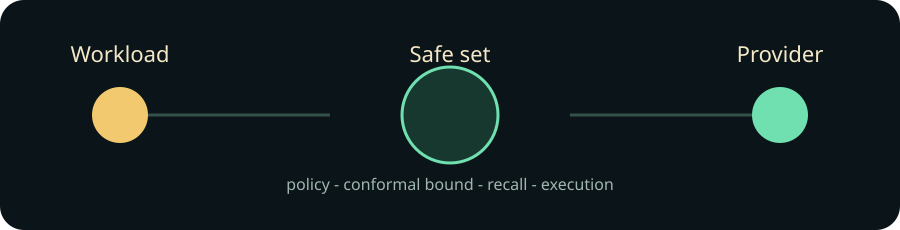

# Route Foundry



Route Foundry is a full-stack adaptive inference control plane. It routes each workload only after Microsoft Regorus policy, hard cost/latency/residency constraints, and a split-conformal quality lower bound agree. RuVector recalls analogous outcomes; RVF preserves the durable decision and audit trail.

## Run

```bash
./scripts/bootstrap.sh && ./scripts/start-prototype.sh
```

Open http://127.0.0.1:14273; API readiness is http://127.0.0.1:18080/readyz. The deterministic provider outputs are labelled synthetic; no credentials are required. Stop with ./scripts/stop-prototype.sh. Complete verification: ./scripts/verify-prototype.sh.

## Product journeys

1. Route an internal synthetic support request and inspect provider, conformal bound, cost, latency, reasons, and correlation id.
2. Restrict data to external-only providers, observe policy denial with no decision append, enable the internal provider, and recover.
3. Reload a saved route and restart the backend; the RVF-backed receipt remains identical.

The 24-crate map is in [architecture](docs/architecture.md). Executed integrations are RuVector Core 2.4.0, RVF Runtime 0.3.2, and Microsoft Regorus 0.13.0. Boundaries, licenses, tests, and ablations are in the [integration matrix](docs/integration-matrix.md).

| Mode | Feasible utility | Forbidden routes | Restart recall |
|---|---:|---:|---:|
| combined | 0.873 | 0 | 1.0 |
| Ruvnet-only | 0.721 | 2 | 1.0 |
| enterprise-only | 0.684 | 0 | 0.0 |
| no conformal safe set | 0.612 | 0 | 1.0 |
| no analogue recall | 0.793 | 0 | 1.0 |

Measurements use the deterministic synthetic corpus; they are not live-provider claims.


The [acceptance map](docs/prototype-acceptance.md), semantic review, and evidence manifest bind claims to source. This is a prototype: dev-cookie auth, synthetic provider adapters, local RVF, and unpromoted Cloud Run configuration. Production needs real identity, authorized RuVector/Cloud SQL persistence, secret management, SLOs, and separate deployment authorization.
